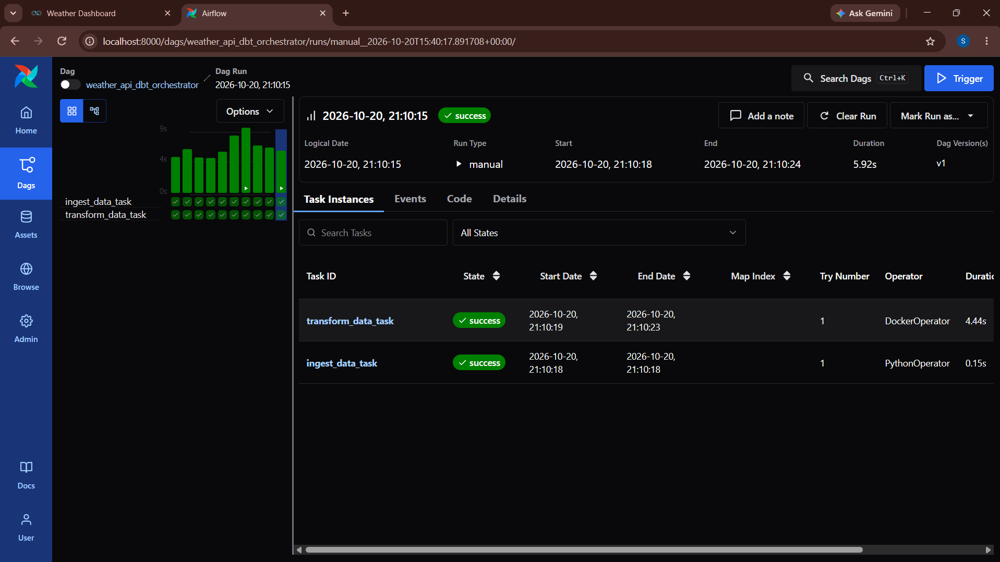
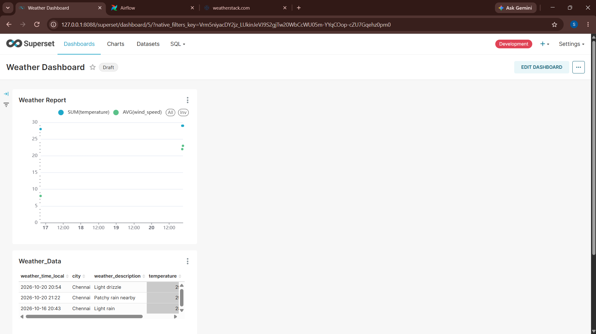
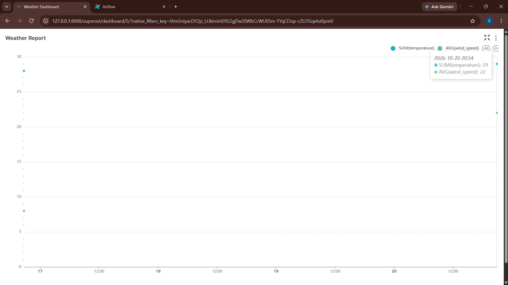

# Weather Data Engineering Pipeline

An end-to-end data engineering project that collects weather data from an external API, stores it in PostgreSQL, orchestrates pipeline tasks using Apache Airflow, transforms data using dbt, and presents weather observations through Apache Superset.

## Overview

This project demonstrates the integration of data ingestion, relational data storage, workflow orchestration, data transformation, and visualization in a containerized environment.

Weather data is retrieved from the Weatherstack API using Python and stored in PostgreSQL. Apache Airflow manages pipeline execution, while dbt supports data transformation and Apache Superset provides a dashboard for exploring weather observations.

The project brings together several commonly used data engineering technologies in a single workflow.

## Architecture

The pipeline consists of the following components:

| Component | Technology | Responsibility |
|---|---|---|
| Data source | Weatherstack API | Provides weather information |
| Ingestion | Python | Retrieves weather data from the API |
| Storage | PostgreSQL | Stores structured weather records |
| Orchestration | Apache Airflow | Coordinates and monitors pipeline tasks |
| Transformation | dbt | Organizes data transformations for analytics |
| Visualization | Apache Superset | Presents weather observations through charts and tables |
| Environment | Docker Compose | Manages the containerized services |

The pipeline integrates API-based data ingestion, relational storage, workflow orchestration, data transformation, and visualization. Apache Airflow coordinates the configured tasks, while Apache Superset provides a visual interface for exploring weather observations.


## Implementation

### 1. Data Ingestion

Python retrieves weather information from the Weatherstack API. The collected data provides the input for subsequent storage and analysis.

### 2. Data Storage

PostgreSQL serves as the relational database for storing structured weather observations. The available records include fields such as observation time, city, weather description, temperature, and wind speed.

### 3. Workflow Orchestration

Apache Airflow manages the pipeline through a Directed Acyclic Graph (DAG). Its interface provides visibility into individual task states, execution times, and run status.

The demonstrated DAG contains ingestion and transformation tasks, both of which completed successfully in the captured run.

### 4. Data Transformation

dbt is used to organize SQL-based data transformations for analytical purposes. The transformation models and their dependencies should be documented according to the actual implementation in the repository.

### 5. Data Visualization

Apache Superset provides a dashboard for exploring the stored weather observations. The current dashboard includes a weather report chart and a table displaying collected records.

## Results

### Airflow Pipeline Execution

The following screenshot shows a successful manual DAG run in Apache Airflow. Both `ingest_data_task` and `transform_data_task` completed successfully.



### Weather Dashboard

The Apache Superset dashboard displays weather observations, including temperature and wind speed, in a chart and also includes a table showing weather records with their local timestamps, city names, weather descriptions, and temperature values.




### Inference

The Weather Report visualization presents recorded temperature and wind speed observations over time. The displayed data point indicates a temperature of 29 and an average wind speed of 22 for the selected observation. These values represent the metrics shown in the dashboard and should be interpreted using the units and aggregation settings configured in the underlying dataset.

The visualization demonstrates how API-collected weather data can be presented in a graphical format for monitoring and analysis. With additional observations over time, the dashboard can support comparisons of weather conditions and help identify changing patterns.



## Technology Stack

- **Python:** API integration and data ingestion.
- **Weatherstack API:** External weather data source.
- **PostgreSQL:** Relational data storage.
- **Apache Airflow:** Pipeline orchestration and execution monitoring.
- **dbt:** SQL-based data transformation.
- **Docker Compose:** Containerized service management.
- **Apache Superset:** Data exploration and visualization.
- **Ubuntu / WSL 2:** Development environment.

## Project Structure

The following is an illustrative structure. Verify the directory and file names against the actual repository.

```text
Weather-Data-Project/
├── api-request/
│   └── Python ingestion scripts
├── dbt/
│   └── dbt models and configuration
├── docker/
│   └── Docker configuration
├── docs/
│   └── images/
│       ├── airflow-dag-run.png
│       ├── weather-dashboard.png
│       └── weather-report.png
├── postegres/
│   └── creating user and databses
├── docker-compose.yml
├── .gitignore
└── README.md
```

## Prerequisites

- Docker Desktop with WSL 2 integration, or a compatible Docker Engine installation.
- Git.
- Ubuntu / WSL 2 or another supported Linux environment.
- A Weatherstack API key.

## Setup

### 1. Clone the repository

```bash
git clone https://github.com/Sooriya07/Weather-Data-Project.git
cd Weather-Data-Project
```

### 2. Configure environment variables

Configure the Weatherstack API key and other required settings according to the project's configuration.

For example:

```env
WEATHER_API_KEY=your_weatherstack_api_key
```

Use the environment-variable names expected by the actual ingestion script and Docker configuration.

Do not commit API keys, passwords, or other secrets to version control.

### 3. Start the services

From the project root, run:

```bash
docker compose up -d
```

Verify the running containers:

```bash
docker compose ps
```

To inspect service logs:

```bash
docker compose logs
```

### 4. Access the applications

Open the application interfaces using the host ports configured in `docker-compose.yml`.

The development environment shown in the screenshots uses:

- Apache Airflow: `http://localhost:8000`
- Apache Superset: `http://127.0.0.1:8088`

The configured port mappings may differ between environments.

### 5. Verify the pipeline

Follow the execution procedure defined in the repository and verify each stage:

1. Confirm that the Python ingestion process retrieves weather data.
2. Verify that the expected records are available in PostgreSQL.
3. Execute the configured Airflow DAG and inspect the task states.
4. Run the applicable dbt transformations and validate their output.
5. Open the Superset dashboard and confirm that the visualizations reflect the available data.

## Security

- Keep API keys and database credentials out of source control.
- Use environment variables for sensitive configuration.
- Exclude local environment files from Git using `.gitignore`.
- Avoid exposing development services publicly without appropriate authentication and access controls.

## Future Improvements

Potential enhancements include:

- Adding automated data quality checks.
- Improving API error handling and retry mechanisms.
- Implementing incremental data ingestion.
- Adding automated tests for transformation models.
- Improving pipeline logging and monitoring.
- Expanding the dashboard with additional analytical views.

These improvements are potential extensions and should not be interpreted as existing functionality.

## Author

**Sooriyaprasath R**

GitHub: [Sooriya07](https://github.com/Sooriya07)
